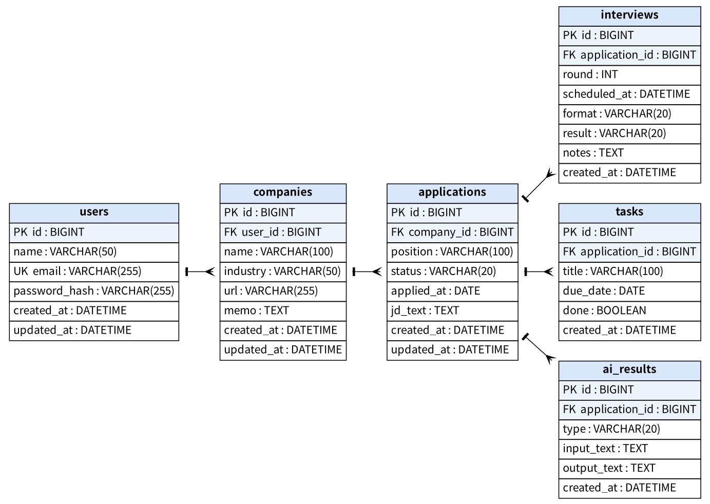

# JobTrack（AI搭載 就職活動管理システム）

就職活動の「抜け漏れ」をなくすためのWebアプリです。
応募企業・選考状況・締切タスクを一か所で管理し、AIが求人票から締切を読み取ってタスクの候補を提案します。
さらに、求人票をやさしい日本語・ベトナム語で解説し、面接の記録から次の面接の想定質問を作り、自分で書いた回答をAIが添削します。

> 個人制作（就職作品）／ 開発期間：2026年10月〜（開発中）

---

## 制作のきっかけ

私はベトナムからの留学生で、アルバイトをしながら日本で就職活動をしています。

- 応募情報が就活サイト・メール・手帳などに分散し、締切を見落としそうになる
- 企業ごとに選考の段階が違い、どこまで進んだか分からなくなる
- 日本語の求人票は専門用語が多く、理解に時間がかかる
- アルバイトのシフトと面接の日程が重なりやすい

この経験から、自分自身が使うためのツールとして制作しました。

### 既存ツールとの違い

| ツール | できること | できないこと |
|---|---|---|
| Googleカレンダー | 予定（時間）の管理・通知 | 企業ごとの選考状況、面接の振り返り |
| ChatGPT など | 文章の要約・会話 | 毎回コピー＆ペーストが必要、結果がデータとして残らない |
| Excel / メモ | 自由な記録 | 入力の手間が大きい、締切の通知がない |
| **JobTrack** | **就活の進み具合を構造化して管理**（企業 → 応募 → タスク） | 予定は .ics でGoogleカレンダーに出力して連携 |

---

## 機能

### 実装済み

| 機能 | 内容 |
|---|---|
| 会員登録・ログイン | Spring Securityによる認証、パスワードはBCryptでハッシュ化 |
| 企業管理 | 登録・一覧・編集・削除、同じユーザー内での企業名の重複チェック |
| 応募管理 | 企業ごとの応募（職種・選考ステータス9種類・応募日・求人票）の登録・一覧・編集・削除 |
| タスク管理 | ES提出・SPIなどの締切を管理、完了／未完了の切り替え、期限切れを赤で表示 |
| ダッシュボード | 登録企業数・応募数、選考ステータス別の件数（9種類）、7日以内に締切のタスク（期限切れを含む）、これからの面接、シフト重複の警告 |
| 面接記録 | 応募ごとの面接（何次・日時・形式・結果・振り返りメモ）の登録・一覧・編集・削除、同じ応募の同じ回の重複チェック |
| アルバイトのシフト | シフトの登録・一覧・編集・削除（終了は開始より後かをチェック） |
| 予定の警告 | シフトと面接の時間の重複を検出、週（月曜始まり）ごとの勤務時間を集計し28時間超過を警告（留学生の資格外活動の上限） |
| カレンダー出力 | 面接と未完了タスクを .ics（iCalendar）で出力し、Googleカレンダー等に取り込める |
| AI締切抽出 | 応募に貼り付けた求人票から、ES提出・SPI受検などの締切をAIが読み取り、タスク候補として提案。利用者が確認・修正してから登録する |
| AI求人票解説 | 求人票を「やさしい日本語」または「ベトナム語」で、仕事内容・必要なスキル・条件・面接までに準備することに分けて解説 |
| AI想定質問 | 職種・求人票・これまでの面接メモから、次の面接で聞かれそうな質問を5つ作成（質問の意図と答え方のヒント付き）。「別の質問を作る」で、前と違う質問を何度でも作れる |
| AI回答添削 | 想定質問に対して自分で書いた回答を、AIが「良い点・改善点・修正例」で添削。修正して何度でも添削できる |
| 共通 | ナビゲーションバー、独自のエラーページ（404） |

### 開発予定

| 時期 | 機能 |
|---|---|
| 第7週 | AWSへのデプロイ |

---

## 使用技術

| 分類 | 技術 |
|---|---|
| 言語 | Java 21 |
| フレームワーク | Spring Boot 4.1（Spring MVC / Spring Data JPA / Spring Security / Bean Validation） |
| 画面 | Thymeleaf、Bootstrap 5 |
| データベース | MySQL 8.4 |
| テスト | JUnit 5、Mockito、AssertJ |
| ビルド | Maven |
| 開発環境 | IntelliJ IDEA、Git / GitHub |
| 生成AI | Groq API（`openai/gpt-oss-120b`）。`AiClient` インターフェースにより、設定だけで Gemini API に切り替え可能 |
| 予定 | AWS（EC2・RDS） |

---

## 設計

### ER図



- `users` → `companies` → `applications` → `interviews` / `tasks` / `ai_results` の階層構造
- 第3正規形で設計（`applications` は `user_id` を持たず、`companies` 経由で所有者を判定）
- 外部キー・UNIQUE・CHECK制約でデータの整合性を確保

### アーキテクチャ

```
ブラウザ → Controller → Service → Repository → MySQL
              ↑            ↑
           Form(DTO)    Entity
```

| パッケージ | 役割 |
|---|---|
| `controller` | リクエストを受け取り、画面を返す |
| `service` | 業務ロジック（所有者チェック、フォーム → エンティティの変換） |
| `repository` | データベースへのアクセス（Spring Data JPA） |
| `entity` | テーブルに対応するクラス |
| `dto` | 画面の入力値と入力チェック |
| `config` | Spring Securityの設定 |
| `ai` | 生成AIの呼び出し（`AiClient` インターフェースと Groq / Gemini の実装） |

---

## 工夫した点

### 1. 他のユーザーのデータにアクセスできない設計

- すべての検索条件にログインユーザーのIDを含めています（例：`findByIdAndUserId`）。
- URLのIDだけでなく、**フォームから送られる企業ID・応募ID**もサーバー側で所有者を確認しています。
- 開発者ツールでHTMLを書き換えて送信するテストを行い、404になることを確認しました。

### 2. N+1問題の防止

- 一覧画面では `@EntityGraph` で関連データを1回のSQLで取得しています。
- 実際に発行されるSQLをログで確認しました。

### 3. 入力データの品質

- 入力値の前後の空白を除去し、空文字は `NULL` として保存しています（`StringTrimmerEditor`）。
- 入力チェックの文字数は、DBの列の長さやBCryptの制限（72バイト）に合わせています。

### 4. 単体テスト

- JUnit 5とMockitoで、データベースを使わずにServiceの処理をテストしています。
- 他人のタスクを取得すると404になること、**他人の応募IDでタスクを作成しようとすると404になり、保存されないこと**をテストで確認しています。
- ダッシュボードの集計では、DBに存在しないステータスも0件として9種類すべて返すことをテストしています。
- シフトと面接の重複判定では、一部が重なる・包含・境界が接するだけ（重複なし）・別の日などの境界値をテストしています。週ごとの勤務時間では、日曜のシフトが前の月曜の週に入ること、28時間超過の判定をテストしています。

### 5. AI機能の設計

- **AIは提案だけ**：結果は自動で保存せず、確認画面で利用者が修正・選択してから登録します。
- **AIの回答を検証**：JSON形式で返すよう指示し、日付の形式・過去の日付・空のタイトル・件数の上限をコード側で必ずチェックしています（AIは指示を守らないことがあるため）。
- **作り話の防止**：プロンプトで「求人票に書かれていないものを作らない」「見つからなければ空のリスト」と指示し、temperature を 0 にしています。
- **API呼び出しの削減**：同じ入力の結果は `ai_results` テーブルに保存して再利用します（2回目は約30〜40ms）。キャッシュは `AiResultCacheService` にまとめ、3つのAI機能で共通に使っています。
- **留学生向けの工夫**：求人票の解説は「やさしい日本語」とベトナム語を選べます。想定質問は面接と同じ丁寧な日本語で、答え方のヒントはやさしい日本語で表示します。応募者を新卒の学生として扱い、実務経験を前提にした質問は作らせません。
- **回答の添削で嘘を作らない**：修正例には、本人の回答に書かれている事実だけを使わせ、足りない部分は【 】で本人が書き足す場所として示します。面接で深く聞かれても本人が答えられるようにするためです。
- **提供元の切り替え**：`AiClient` インターフェースで抽象化し、`ai.provider` の設定だけで Groq と Gemini を切り替えられます。
- **安全性**：APIキーは環境変数で管理し、AIには求人票の本文だけを送ります（個人情報は送りません）。
- 正しいJSON・壊れたJSON・日付の形式違い・過去日・空の回答・件数の上限・キャッシュの有無などを、AI機能だけで34個の単体テストで確認しています（全体で47個）。
- プロンプトの品質は単体テストでは分からないため、実際に動かして結果を読み、「実務経験を前提にした質問」や「回答にない成果を足した修正例」を見つけて改善しました。

### 6. その他のセキュリティ対策

- CSRF対策（フォームにトークンを自動付与、ログアウトはPOST）
- XSS対策（`th:text` で出力をエスケープ）
- DBのパスワードは環境変数で管理し、Gitには含めない
- アプリ用のDBユーザーは必要最小限の権限のみ

開発中に苦労した点と解決方法は [docs/difficulties.md](docs/difficulties.md) にまとめています。

---

## ローカルでの起動方法

### 1. データベースの準備

```bash
mysql -u root -p < database/schema.sql
mysql -u root -p --default-character-set=utf8mb4 jobtrack < database/seed.sql
```

既存のDB（第3週以前に作成）を使う場合は、`schema.sql` を再実行せずに追加分だけ実行します（`schema.sql` はDBを作り直します）。

```bash
mysql -u root -p jobtrack < database/migrations/001_create_part_time_shifts.sql
```

`database/create_app_user.sql` の `CHANGE_ME` を任意のパスワードに変更してから実行します。

```bash
mysql -u root -p < database/create_app_user.sql
```

### 2. 環境変数の設定

| 変数名 | 内容 |
|---|---|
| `DB_USERNAME` | `jobtrack_app`（省略可） |
| `DB_PASSWORD` | 上で設定したパスワード |
| `GROQ_API_KEY` | Groq の APIキー（AI機能を使う場合。[console.groq.com](https://console.groq.com) で発行） |
| `GROQ_MODEL` | 使用するモデル（省略可、初期値 `openai/gpt-oss-120b`） |

### 3. 起動・テスト

```bash
./mvnw spring-boot:run
```

http://localhost:8080 にアクセスします。

テストの実行：

```bash
./mvnw test
```

### デモアカウント

| メールアドレス | パスワード |
|---|---|
| demo@jobtrack.local | password123 |

---

## 作者

Vo Nhu Khang（ベトナム出身・日本のIT専門学校在学中）
