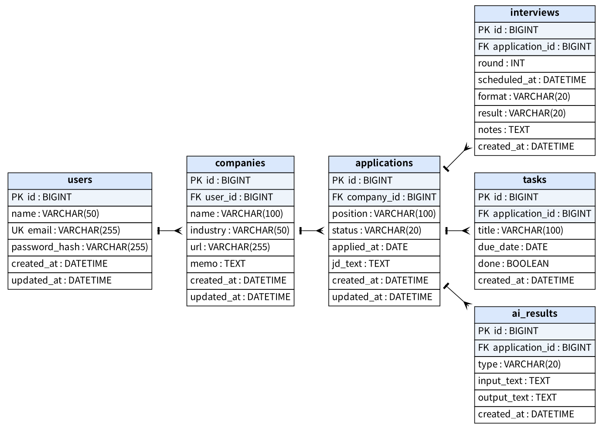

# JobTrack（AI搭載 就職活動管理システム）

就職活動の「抜け漏れ」をなくすためのWebアプリです。
応募企業・選考状況・締切タスクを一か所で管理し、今後はAIが求人票から締切を読み取ってタスクを自動作成する機能を追加します。

> 個人制作（就職作品）／ 開発期間：2026年10月〜（開発中）

---

## 制作のきっかけ

私はベトナムからの留学生で、アルバイトをしながら日本で就職活動をしています。

- 応募情報が就活サイト・メール・手帳などに分散し、締切を見落としそうになる
- 企業ごとに選考の段階が違い、どこまで進んだか分からなくなる
- 日本語の求人票は専門用語が多く、理解に時間がかかる
- アルバイトのシフトと面接の日程が重なりやすい

この経験から、自分自身が使うためのツールとして制作しました。

### 既存ツールとの違い

| ツール | できること | できないこと |
|---|---|---|
| Googleカレンダー | 予定（時間）の管理・通知 | 企業ごとの選考状況、面接の振り返り |
| ChatGPT など | 文章の要約・会話 | 毎回コピー＆ペーストが必要、結果がデータとして残らない |
| Excel / メモ | 自由な記録 | 入力の手間が大きい、締切の通知がない |
| **JobTrack** | **就活の進み具合を構造化して管理**（企業 → 応募 → タスク） | 予定の通知はGoogleカレンダーと連携する予定 |

---

## 機能

### 実装済み

| 機能 | 内容 |
|---|---|
| 会員登録・ログイン | Spring Securityによる認証、パスワードはBCryptでハッシュ化 |
| 企業管理 | 登録・一覧・編集・削除、同じユーザー内での企業名の重複チェック |
| 応募管理 | 企業ごとの応募（職種・選考ステータス9種類・応募日・求人票）の登録・一覧・編集・削除 |
| タスク管理 | ES提出・SPIなどの締切を管理、完了／未完了の切り替え、期限切れを赤で表示 |
| 共通 | ナビゲーションバー、独自のエラーページ（404） |

### 開発予定

| 時期 | 機能 |
|---|---|
| 第3週 | ダッシュボード（ステータス別件数、締切が近いタスク）、テスト（JUnit） |
| 第4週 | 面接記録、アルバイトのシフト登録、予定の重複・週28時間超過の警告、Googleカレンダー出力（.ics） |
| 第5〜6週 | AI機能：求人票から企業名・締切を抽出してタスクを自動作成、やさしい日本語・ベトナム語での解説、面接メモを元にした想定質問 |
| 第7週 | AWSへのデプロイ |

---

## 使用技術

| 分類 | 技術 |
|---|---|
| 言語 | Java 21 |
| フレームワーク | Spring Boot 4.1（Spring MVC / Spring Data JPA / Spring Security / Bean Validation） |
| 画面 | Thymeleaf、Bootstrap 5 |
| データベース | MySQL 8.4 |
| ビルド | Maven |
| 開発環境 | IntelliJ IDEA、Git / GitHub |
| 予定 | 生成AI API（Gemini API または AWS Bedrock）、JUnit 5、AWS（EC2・RDS） |

---

## 設計

### ER図



- `users` → `companies` → `applications` → `interviews` / `tasks` / `ai_results` の階層構造
- 第3正規形で設計（`applications` は `user_id` を持たず、`companies` 経由で所有者を判定）
- 外部キー・UNIQUE・CHECK制約でデータの整合性を確保

### アーキテクチャ

```
ブラウザ → Controller → Service → Repository → MySQL
              ↑            ↑
           Form(DTO)    Entity
```

| パッケージ | 役割 |
|---|---|
| `controller` | リクエストを受け取り、画面を返す |
| `service` | 業務ロジック（所有者チェック、フォーム → エンティティの変換） |
| `repository` | データベースへのアクセス（Spring Data JPA） |
| `entity` | テーブルに対応するクラス |
| `dto` | 画面の入力値と入力チェック |
| `config` | Spring Securityの設定 |

---

## 工夫した点

### 1. 他のユーザーのデータにアクセスできない設計

- すべての検索条件にログインユーザーのIDを含めています（例：`findByIdAndUserId`）。
- URLのIDだけでなく、**フォームから送られる企業ID・応募ID**もサーバー側で所有者を確認しています。
- 開発者ツールでHTMLを書き換えて送信するテストを行い、404になることを確認しました。

### 2. N+1問題の防止

- 一覧画面では `@EntityGraph` で関連データを1回のSQLで取得しています。
- 実際に発行されるSQLをログで確認しました。

### 3. 入力データの品質

- 入力値の前後の空白を除去し、空文字は `NULL` として保存しています（`StringTrimmerEditor`）。
- 入力チェックの文字数は、DBの列の長さやBCryptの制限（72バイト）に合わせています。

### 4. その他のセキュリティ対策

- CSRF対策（フォームにトークンを自動付与、ログアウトはPOST）
- XSS対策（`th:text` で出力をエスケープ）
- DBのパスワードは環境変数で管理し、Gitには含めない
- アプリ用のDBユーザーは必要最小限の権限のみ

開発中に苦労した点と解決方法は [docs/difficulties.md](docs/difficulties.md) にまとめています。

---

## ローカルでの起動方法

### 1. データベースの準備

```bash
mysql -u root -p < database/schema.sql
mysql -u root -p --default-character-set=utf8mb4 jobtrack < database/seed.sql
```

`database/create_app_user.sql` の `CHANGE_ME` を任意のパスワードに変更してから実行します。

```bash
mysql -u root -p < database/create_app_user.sql
```

### 2. 環境変数の設定

| 変数名 | 内容 |
|---|---|
| `DB_USERNAME` | `jobtrack_app`（省略可） |
| `DB_PASSWORD` | 上で設定したパスワード |

### 3. 起動

```bash
./mvnw spring-boot:run
```

http://localhost:8080 にアクセスします。

### デモアカウント

| メールアドレス | パスワード |
|---|---|
| demo@jobtrack.local | password123 |

---

## 作者

Vo Nhu Khang（ベトナム出身・日本のIT専門学校在学中）
